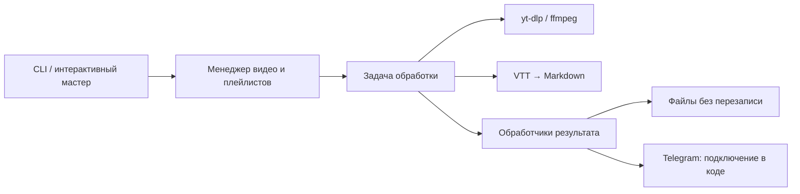

<div align="center">

# YtdlpJava

**От YouTube-ссылки до текста, аудио и кадров — из командной строки.**


[](https://github.com/ursusandwolf/YtdlpJava/actions/workflows/ci.yml)
[](https://github.com/ursusandwolf/YtdlpJava/releases/latest)
[](LICENSE)


[Скачать v1.0.0](https://github.com/ursusandwolf/YtdlpJava/releases/tag/v1.0.0) · [Быстрый старт](#быстрый-старт) · [Примеры](#примеры) · [Параметры](#параметры-cli) · [Архитектура](docs/DOCUMENTATION.md) · [Changelog](CHANGELOG.md)

</div>

YtdlpJava — приложение на Java 21, которое использует `yt-dlp` для получения
YouTube-контента и `ffmpeg` для обработки медиа. Оно превращает VTT-субтитры
в читаемый Markdown, извлекает аудио, сохраняет видео и метаданные,
создаёт серии кадров. Можно обработать одно видео, несколько ссылок или плейлист.

## Что умеет проект

| Задача | Результат | Каталог по умолчанию |
|---|---|---|
| **Субтитры** | Markdown: очищенный текст, таймкоды, выделенные ключевые слова и их список | `txt/` |
| **Аудио** | OPUS, MP3 или M4A с выбранным качеством | `output/audio/` |
| **Видео** | Видеофайл с предпочтением MP4 до 720p | `output/video/` |
| **Кадры** | JPEG через заданный интервал | `output/img/` |
| **Метаданные** | JSON с данными видео | `output/metadata/` |

Для ключевых слов настроены анализаторы и словари семи языков:
**английского, русского, украинского, немецкого, испанского, французского и итальянского**.

Результаты плейлистов группируются по названию. Совпадающие имена получают
суффиксы ` (1)`, ` (2)` и далее, поэтому предыдущие файлы сохраняются.
Каждая загрузка использует отдельный временный каталог; файлы рабочего каталога
не используются как промежуточные результаты.
Небезопасные названия преобразуются: `CON` → `_CON`, `..` → `video`;
точки и пробелы на конце имени удаляются. Папка плейлиста остаётся внутри каталога результата.
Ошибки отдельных видео не мешают обработать остальные ссылки.

Для субтитров запрашиваются авторские дорожки и автоматические, если авторских
на выбранном языке нет. Парсер поддерживает LF/CRLF/CR и таймкоды с часами или без.
Если длительность видео неизвестна, задача кадров завершается с ошибкой.

## Быстрый старт

### 1. Подготовьте инструменты

| Инструмент | Для чего нужен |
|---|---|
| **Java 21+** | Запуск готового JAR; для разработки нужен JDK 21 |
| **Maven** | Только сборка из исходников и тесты |
| **yt-dlp** | Контент, субтитры и метаданные |
| **ffmpeg** | Аудио, объединение потоков и извлечение кадров |
| **Node.js** | JS runtime: приложение передаёт `--js-runtimes node` в yt-dlp |

Команды должны быть доступны в `PATH`. Проверить окружение можно так:

```shell
java -version
yt-dlp --version
ffmpeg -version
node --version
```

### 2. Скачайте готовый релиз

На [странице v1.0.0](https://github.com/ursusandwolf/YtdlpJava/releases/tag/v1.0.0)
скачайте `ytdlp-java-1.0.0.jar` и `SHA256SUMS` в одну папку.
JAR содержит Java-зависимости и словари семи языков.

Для проверки SHA-256 используйте `Get-FileHash ytdlp-java-1.0.0.jar -Algorithm SHA256`
в PowerShell или `sha256sum -c SHA256SUMS` в Linux; значение должно совпадать с `SHA256SUMS`.

### 3. Запустите приложение

```shell
java -jar ytdlp-java-1.0.0.jar --help
java -jar ytdlp-java-1.0.0.jar
```

Без URL откроется интерактивный мастер: он предложит выбрать ссылку, задачу
и язык субтитров или формат аудио. Для справки добавьте `--help`.

> `yt-dlp`, FFmpeg и Node.js устанавливаются отдельно и должны быть доступны в PATH.
> После установки инструментов перезапустите терминал и IDE.

## Примеры

Команды одинаковы в PowerShell, Linux и macOS.
Замените `VIDEO_ID` и `PLAYLIST_ID` на свои идентификаторы.

### Субтитры на русском

```powershell
java -jar ytdlp-java-1.0.0.jar "https://youtu.be/VIDEO_ID" -t sub -l ru
```

### Аудио в MP3

```powershell
java -jar ytdlp-java-1.0.0.jar "https://youtu.be/VIDEO_ID" -t audio --format mp3 --quality 0
```

### Кадр каждые 30 секунд

```powershell
java -jar ytdlp-java-1.0.0.jar "https://youtu.be/VIDEO_ID" -t screenshot -i 30
```

### Видео из плейлиста

```powershell
java -jar ytdlp-java-1.0.0.jar "https://www.youtube.com/playlist?list=PLAYLIST_ID" -t video
```

### Метаданные в отдельный каталог

```powershell
java -jar ytdlp-java-1.0.0.jar "https://youtu.be/VIDEO_ID" -t metadata -o downloads/metadata
```

### Несколько ссылок за один запуск

```powershell
java -jar ytdlp-java-1.0.0.jar "https://youtu.be/FIRST_ID" "https://youtu.be/SECOND_ID" -t sub -l de
```

## Параметры CLI

| Параметр | Назначение | По умолчанию |
|---|---|---|
| URL | Одна или несколько позиционных ссылок | Интерактивный ввод |
| `-t`, `--type` | `sub`, `audio`, `video`, `screenshot`, `metadata` | `sub` |
| `-o`, `--output_dir` | Каталог результата | Зависит от задачи |
| `-l`, `--lang` | Код языка субтитров | `en` |
| `--format` | `opus`, `mp3`, `m4a` | `opus` |
| `--quality` | Целое число: `0` — лучшее, `9` — худшее | `0` |
| `-i`, `--interval` | Положительный интервал кадров, секунды | `60` |
| `-h`, `--help` | Справка | — |

Коды языков с настроенным анализом: `en`, `ru`, `uk`, `de`, `es`, `fr`, `it`.
Для других кодов применяется английский анализатор; отдельного словаря может не быть.
Наличие субтитров выбранного языка зависит от видео.

`-o output` преобразуется в стандартный каталог задачи. Любой другой путь,
например `-o downloads`, используется как указано. Для плейлиста внутри него
создаётся папка с обработанным названием, если удалось получить название.

### Коды завершения

| Код | Значение |
|---|---|
| `0` | Обработка завершилась без ошибок или показана справка |
| `1` | Ошибка обработки хотя бы одного элемента, ошибка приложения или пустой список видео |
| `2` | Неверные аргументы |

Сводка успешных и неуспешных элементов выводится в лог.
Прерывание останавливает дальнейшую обработку.

## Как устроен проект



`ApplicationFactory` собирает зависимости, задачи используют узкие интерфейсы,
а инфраструктурные адаптеры вызывают внешние инструменты. Исходный результат
доступен всем обработчикам, затем задача очищает временные файлы.
Анализаторы текста живут до завершения всей партии URL и закрываются при выходе.

[Описание архитектуры](docs/DOCUMENTATION.md) · [UML классов и последовательностей](docs/UML.md)

## Проверки и разработка

```shell
git clone https://github.com/ursusandwolf/YtdlpJava.git
cd YtdlpJava
mvn clean verify
java -jar target/ytdlp-java-1.0.0.jar --help
```

Набор содержит **120 модульных проверок и 3 проверки готового JAR**.
GitHub Actions выполняет `mvn clean verify` на Java 21 под Windows и Linux.
Проверяется запуск JAR из другой папки, коды завершения и наличие словарей.
Модульный набор покрывает таймауты реальных дочерних Java-процессов,
каталоги плейлистов, параллельные коллизии файлов, обработчики результатов,
проверки CLI, ответы Telegram через mock и обработку текста. Добавлены проверки
изоляции загрузок и очистки при сбоях, прерывания запросов, повторов HTTP 503
и таймаутов, VTT с разными переносами строк и Unicode-ключевых слов.
Отдельно проверены повторы загрузки метаданных и имена с буквальными `%`.
Проверены также переносимые имена, границы каталогов плейлистов и относительные пути загрузок.
Реальный прогон на YouTube Shorts проверил все пять задач и выявил исправленную ошибку
кодировки кириллицы в Windows. [Результаты и повторение проверки](docs/INTEGRATION_CHECKS.md).
Результаты проверки и подробности исправлений: [анализ кода](docs/coderev.md).
Дополнительно проверены недоступное видео, продолжение после ошибки, повторная
загрузка без перезаписи, прерывание настоящего скачивания и контролируемый плейлист.

Для изменений добавляйте проверки соответствующего сценария,
обновляйте [changelog](CHANGELOG.md) и документацию затронутого поведения.
Предыдущий пакет исправлений опубликован в `main` коммитом `2bb5c62`;
результаты повторного ревью от 2026-10-20 описаны в анализе кода и интеграционном отчёте.
[Итоги слияния](docs/MERGE.md) · [Состояние проекта и дальнейшие шаги](docs/PROJECT_CONTEXT.md)

## Ограничения

- Поддерживаются только VTT-субтитры. Если VTT недоступен, приложение сообщает об ошибке.
- Последний резервный формат видео `best` может превышать 720p.
- Telegram-адаптер проверяет ответ API, но CLI пока не предоставляет флаги токена и chat ID.
- Предел абзаца применяется до добавления Markdown-разметки.
- Все пять задач проверены на Shorts; публичный плейлист из шести уроков немецкого
  проверен через исполняемый JAR для метаданных и немецких субтитров.
  Отправка Telegram пока проверена только mock-тестами.
- Используется SLF4J/Logback; собственного `logback.xml` в репозитории нет.

## Документация

| Документ | Содержание |
|---|---|
| [Архитектура](docs/DOCUMENTATION.md) | Пакеты, зависимости и потоки данных |
| [UML](docs/UML.md) | Классы, обработка плейлистов и жизненный цикл результата |
| [Changelog](CHANGELOG.md) | Единая история изменений |
| [Релиз v1.0.0](docs/releases/v1.0.0.md) | Возможности, установка, проверки и ограничения выпуска |
| [Процесс выпуска](docs/RELEASING.md) | Сборка, CI, контрольные суммы и публикация |
| [Внешние зависимости](THIRD_PARTY_NOTICES.md) | Состав JAR и уведомления о лицензиях |
| [Анализ кода](docs/coderev.md) | Исправленные находки, проверки и ограничения |
| [Контекст проекта](docs/PROJECT_CONTEXT.md) | Состояние выпуска и возможные улучшения |
| [Итоги слияния](docs/MERGE.md) | Выполненное слияние и архив подготовительного документа |
| [Пакет субтитров](src/main/java/com/ytdlpjava/subtitle/README.md) | API обработки VTT |

## Лицензия

[MIT](LICENSE), © 2026 ursusandwolf. Внешние компоненты сохраняют собственные лицензии;
см. [уведомления о зависимостях](THIRD_PARTY_NOTICES.md).
