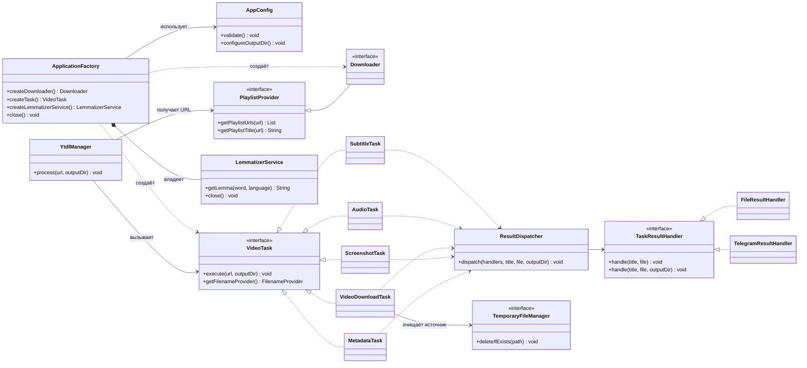
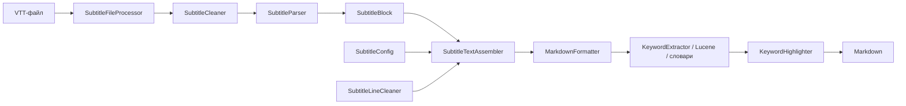
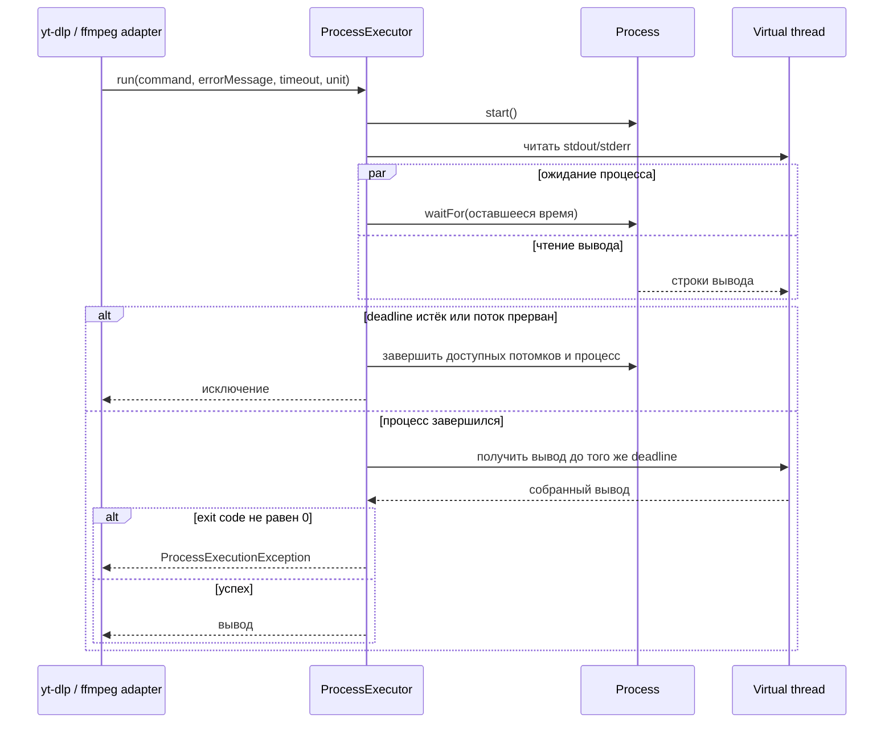

# UML YtdlpJava

Диаграммы описывают классы и сценарии в `main`, коммит `2bb5c62` от 2026-10-11.
GitHub отображает блоки Mermaid прямо в Markdown.
[Архитектура](DOCUMENTATION.md) · [README](../README.md) · [Changelog](../CHANGELOG.md)

## Основные классы и контракты



Сигнатуры фабрики сокращены до имени и возвращаемого типа.
`Downloader` объединяет `PlaylistProvider` и другие узкие порты загрузки/метаданных.
Все пять задач используют временные файлы и общий dispatcher.
Фабрика создаёт анализаторы лениво и закрывается CLI после всей партии URL.

## Плейлист и итоговый статус

```mermaid
sequenceDiagram
    participant CLI as cli.Main
    participant Manager as YtdlManager
    participant Provider as PlaylistProvider
    participant Task as VideoTask
    CLI->>Manager: process(url, baseOutputDir)
    Manager->>Provider: getPlaylistUrls(url)
    Provider-->>Manager: список видео
    alt список пуст
        Manager-->>CLI: YtdlManagerException
    else список непустой
        opt плейлист
            Manager->>Provider: getPlaylistTitle(url)
            Provider-->>Manager: название
            Note over Manager: Выбрать и создать каталог плейлиста
        end
        loop каждое видео
            Manager->>Task: execute(videoUrl, effectiveOutputDir)
            alt успех
                Task-->>Manager: готово
            else обычная ошибка
                Task-->>Manager: Exception
                Note over Manager: Записать ошибку и продолжить
            end
        end
        Note over Manager: Вывести сводку
        alt были ошибки
            Manager-->>CLI: YtdlManagerException со сведениями об ошибках
        else всё успешно
            Manager-->>CLI: готово
        end
    end
    Note over CLI: Продолжить остальные URL; итоговый код 1 при любой ошибке
```

Прерывание обрабатывается отдельно: флаг interrupt сохраняется, дальнейшие элементы
и URL не запускаются. Неверные параметры отклоняются до создания адаптеров с кодом `2`.

## Жизненный цикл результата

```mermaid
sequenceDiagram
    participant Task as VideoTask
    participant Dispatch as ResultDispatcher
    participant Files as FileResultHandler
    participant Next as Следующий обработчик
    participant Temp as TemporaryFileManager
    Task->>Dispatch: dispatch(handlers, title, source, outputDir)
    Dispatch->>Files: handle(title, source, outputDir)
    Note over Files: CREATE_NEW резервирует имя; при коллизии добавить суффикс
    Files->>Files: скопировать источник
    Files-->>Dispatch: результат или ошибка
    Dispatch->>Next: handle(title, source, outputDir)
    Note over Next: Исходный файл по-прежнему доступен
    Next-->>Dispatch: результат или ошибка
    alt хотя бы один обработчик неуспешен
        Dispatch-->>Task: агрегированная Exception
    else все обработчики успешны
        Dispatch-->>Task: готово
    end
    Task->>Temp: deleteIfExists(source) в finally
```

Обычный сбой обработчика не мешает остальным. Прерывание останавливает цепочку.
Telegram-адаптер проверяет `SendResponse.isOk()`; CLI по умолчанию подключает только файлы.

## Обработка субтитров



Внешняя загрузка заканчивается до начала обработки текста. Все резервные стратегии
запрашивают VTT. Сборщик применяет мягкий и жёсткий пороги абзацев;
Markdown-разметка добавляется позднее.

## Внешний процесс и таймаут



Таймаут по умолчанию — 30 минут. Дочерние процессы завершаются через ProcessHandle;
отделившиеся от родителя процессы могут быть недоступны этому механизму.
